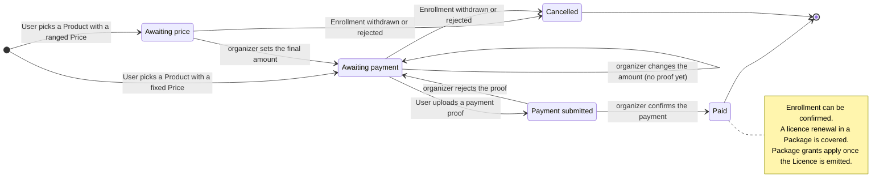

# Statuses and lifecycles

## Licence Request

| Status | Meaning | Next |
|---|---|---|
| Draft | Being filled in; kept for as long as needed. The User can delete it | Submitted |
| Submitted | Sent to the organizer | In review, Rejected |
| In review | Set on the organizer's first action (marking a document as viewed, or commenting). The organizer reviews the documents and sections, like a pull request review | Changes requested, Verified, Rejected |
| Changes requested | The organizer finished the review sending the comments to fix | Submitted |
| Verified | The organizer finished the review with every document viewed and nothing to fix, and set the amount to pay | With the provider, Emitted, Rejected |
| With the provider | Optional: handed to the Licence Provider, waiting for the licence. Requires the payment to be paid or covered | Emitted, Rejected |
| Emitted | The temporary licence PDF is uploaded and the Licence is created. Requires the payment to be paid or covered | — |
| Rejected | Closed without a licence | — |

A Licence Request is a renewal and is paid on its own, not through an Order:

| Payment status | Meaning | Next |
|---|---|---|
| Awaiting the amount | The organizer sets the amount when verifying the request. No payment proof can be uploaded yet | To pay |
| To pay | The amount is set; no payment proof yet. The organizer can still change it | Proof uploaded, Paid |
| Proof uploaded | A payment proof is uploaded | Paid, To pay |
| Paid | The organizer confirmed the bank transfer proof, or recorded a cash or credit card payment at the office | — |
| Covered | A paid Promotional Package Order includes the renewal | — |

## Licence

| Status | Meaning |
|---|---|
| Emitted | Created from a Licence Request |
| Declared | Entered by the User, not yet verified |
| Declared, verified | Entered by the User and checked by the organizer |

## Enrollment

| Status | Meaning | Next |
|---|---|---|
| Draft | Being filled in | Submitted |
| Submitted | Waiting for the organizer. When it names an open Licence Request instead of a Licence, it also waits for the licence | Confirmed, Rejected, Withdrawn |
| Confirmed | Accepted by the organizer. Confirms the race number reservation | Withdrawn |
| Rejected | Not accepted | — |
| Withdrawn | Cancelled by the driver while submitted, or by the organizer at any time | — |

The organizer always confirms an Enrollment by hand. Free enrollments only skip the payment step. A Declared Licence must be verified before its Enrollment is confirmed. When the Licence Request an Enrollment waits for is emitted, the Enrollment moves to the new Licence; when it is rejected, the Enrollment stays submitted until the organizer rejects it or the User picks another Licence. Refunds for withdrawn or rejected paid enrollments, and for rejected licence requests, are settled by email with the organizer, outside the platform.

## BIB Reservation

| Status | Meaning | Next |
|---|---|---|
| Pending | Picked by a driver during enrollment; blocks the number for others. The driver can change their pick | Confirmed, Released |
| Confirmed | Confirmed with the Enrollment, or created by the organizer. Only the organizer can change it | Released |
| Released | Freed by the organizer | — |

Pending reservations don't expire. Reservations created by the organizer may have an expiry date. Reservations created before statuses existed are confirmed. A released reservation can't be changed.

## Order

| Status | Meaning | Next |
|---|---|---|
| Awaiting price | Created for a Product priced as a range; the organizer sets the final amount after reviewing the request. No payment proof can be uploaded yet | Awaiting payment, Cancelled |
| Awaiting payment | Created for a fixed-price Product, or priced by the organizer; no payment proof yet | Payment submitted, Cancelled |
| Payment submitted | A payment proof is uploaded | Paid, Awaiting payment |
| Paid | The organizer confirmed the payment; what was bought is granted. Grants that need a Licence wait until it is emitted | — |
| Cancelled | Its Enrollment was withdrawn or rejected before payment | — |

An Order is created as soon as the User picks the Product to buy, and locks the Price valid at that moment, fixed or range. It can be paid later. When setting the final amount, the organizer starts from the locked Price; an amount outside its range needs a reason, shown to the User. The amount can change until a payment proof is uploaded.

The diagram shows the Order with what moves it: the User picking a Product, the organizer's actions on price and payment, the Enrollment that cancels it, and what a paid Order unlocks.

## Promo Code

| Status | Meaning |
|---|---|
| Unclaimed | Issued, not yet claimed. Anyone with the code can claim it. The organizer can revoke it |
| Revoked | Withdrawn by the organizer before being claimed |
| Claimed | Claimed for one Licence valid in the championship's year, or for a licence number typed in a race registration; has become an Entitlement |

A licence number claim moves to a Licence with that number once the Licence is emitted or verified. The championship's year is the year it starts.
